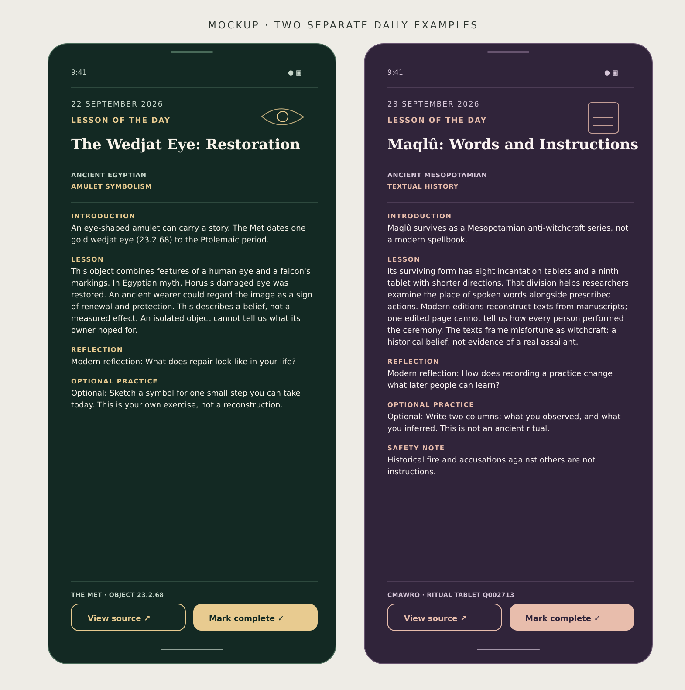

# Lesson detail mockup

This static concept shows two different dates and proposed dark palette options. It is not a screenshot of the Android app or evidence that either lesson was approved for publication. The line art and UI elements were made for this mockup; no museum imagery or manuscript scans are reproduced.

- Wedjat-eye lesson: [The Metropolitan Museum of Art, object 23.2.68](https://www.metmuseum.org/art/collection/search/547767) and [ancient Egyptian amulets essay](https://www.metmuseum.org/essays/egyptian-amulets).
- Maqlû lesson: [CMAwRo project description](https://www.phil.uni-wuerzburg.de/cmawro/magic-witchcraft/maqlu/) and [Oracc ritual tablet Q002713](https://oracc.museum.upenn.edu/cmawro/maqlu/Q002713/html).

These links support original historical summaries. Access to their essays, editions, translations, or images does not by itself grant republication rights. Editorial and rights review are required before any lesson text enters the app.
